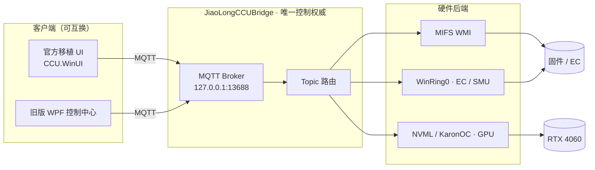

<div align="center">

# 蛟龙电竞控制台

**把机械革命最新版「电竞控制台」移植到 2023 款蛟龙 16 Pro，并重写整套硬件控制后端**

[](https://github.com/l2208568163-sys/JiaoLongControlCenter/releases)
[](https://github.com/l2208568163-sys/JiaoLongControlCenter/releases)
[](#-适用机型)
[](https://dotnet.microsoft.com/)
[](https://github.com/l2208568163-sys/JiaoLongControlCenter/commits/main)
[](https://github.com/l2208568163-sys/JiaoLongControlCenter/stargazers)

[快速开始](#-快速开始) · [功能特性](#-功能特性) · [工作原理](#-工作原理) · [从源码构建](#-从源码构建) · [常见问题](#-常见问题) · [免责声明](#️-免责声明)

</div>

---

## 📖 项目简介

官方「机械革命控制中心 5.56（GX 包）」装不进 **蛟龙 16 Pro 2023（主板 MRID6，同方底盘）**——它的硬件层驱动只绑定 Uniwill 准系统的 `INOU0000` ACPI 设备，这台机器 BIOS 里根本没有；而原厂预装的旧版控制中心功能残缺。

本项目的做法是 **UI 原样保留，后端整个重写**：

> 官方 UI 通过 MQTT（`127.0.0.1:13688`）与自家服务通信。我们实现同一套协议，但硬件操作全部改走这台机器**固件自带**的 MIFS WMI 接口（`root\WMI\MICommonInterface`）——不装任何内核驱动，也不碰 EC 危险寄存器。

结果是：**能装、能用、比官方方案更干净**。

### 解决了什么

- ✅ 官方 5.56 全套 UI（首页监控 / 性能模式 / 风扇 / 灯光 / 显示 / 电池）在 MRID6 上跑起来
- ✅ 风扇曲线、CPU 功耗墙、全核降压、GPU 超频全部真实生效（逐项实测，非界面回显）
- ✅ 顺带修掉官方 UI 的几处真 bug：单实例激活会永久挂在僵尸进程上、侧栏残留无效的应用商店入口
- ✅ 新旧两套客户端（官方 UI / 旧版 WPF 控制中心）统一由桥接服务控制，不再互抢风扇

---

## 🚀 快速开始

### 方式一：下载 Release（推荐）

前往 [**Releases**](https://github.com/l2208568163-sys/JiaoLongControlCenter/releases/latest) 下载：

| 资产 | 说明 |
|---|---|
| `JiaoLongCCU-Port-v1.0.zip` | **完整安装包**，包含 UI、桥接服务、运行时依赖与安装脚本 |
| `JiaoLongCCUBridge-v1.0.zip` | 仅桥接服务，自备 UI 或只需要控制后端时使用 |

### 方式二：直接用仓库里的安装包

仓库已**内嵌完整安装包**，克隆后即可安装，无需另外下载：

```bash
git clone https://github.com/l2208568163-sys/JiaoLongControlCenter.git
cd JiaoLongControlCenter/Port/dist/JiaoLongCCU-Port-v1.0
```

### 安装步骤

1. **先关闭**其他风扇 / 性能控制软件（原厂控制中心、第三方「蛟龙游戏控制中心」、XTU、Ryzen Master 等）——两个程序同时控风扇会打架。
2. 右键 `1-安装移植版控制台.ps1` → **使用 PowerShell 运行**（需管理员授权）。
3. 桌面出现【机械革命控制中心】快捷方式，双击启动。

卸载：右键 `2-卸载移植版控制台.ps1` → 使用 PowerShell 运行。

> 首次启动若卡在加载页超过 60 秒，管理员执行 `net stop JiaoLongCCUBridge && net start JiaoLongCCUBridge` 后重开即可。

---

## ✨ 功能特性

| 功能 | 状态 | 实现通道 |
|---|:---:|---|
| 首页监控（CPU/GPU 温度·占用·频率·显存、双风扇转速） | ✅ | 固件 + NVML |
| 性能模式（办公 / 均衡 / 狂暴 / 自定义） | ✅ | 固件 `SystemPerMode` |
| 一键强冷 | ✅ | EC 直写 100% 占空比 |
| 自定义风扇曲线（CPU/GPU 独立或同步） | ✅ | 同步=固件锁速；独立=WinRing0 直写 EC `0xC83C/0xC83D` |
| CPU 功耗墙 SPL / SPPT / FPPT / 温度墙 | ✅ | MIFS `CPUPower` |
| CPU 全核降压（Curve Optimizer，0–50 步） | ✅ | SMU `set-coall`（WinRing0） |
| GPU 超频（核心 / 显存偏移） | ✅ | KaronOC P0 偏移 |
| GPU 锁频（145 档，210–3105 MHz） | ✅ | NVML `SetGpuLockedClocks` |
| 键盘灯效 + 定时关灯 | ✅ | 固件；彩虹/波浪映射到固件流光 |
| Fn 键锁定 / 触摸板开关 / 独显直连 | ✅ | 固件 `fn11` / `fn12` / `fn9` |
| 屏幕刷新率切换（240 / 60 Hz） | ✅ | Windows Display API |
| 屏幕校色（sRGB） | ✅ | ICC 关联 |
| 主页 Logo 三连击自定义图标 | ✨ | 0.9 秒内连点 3 次 |
| 快捷菜单 WiFi / 蓝牙 | ⚠️ | 仅回显（本机无固件接口） |
| 电池养护模式 | ⚠️ | 仅回显（BIOS 无充电阈值，`fn0–160` 已全扫） |
| 局部调光 / OLED 保养 / OTA / 应用商店 | ⛔ | 本机硬件不存在，已隐藏或移除 |

<sub>✅ 实测生效 ｜ ✨ 本项目新增 ｜ ⚠️ 仅界面回显 ｜ ⛔ 不支持</sub>

---

## 🖥 适用机型

| 项目 | 规格 |
|---|---|
| 机型 | 蛟龙 16 Pro 2023（MRID6-23，同方底盘） |
| 已验证 CPU | R7 7745HX（8C16T，Zen 4） |
| 已验证 GPU | RTX 4060 Laptop |
| 系统 | Windows 11 22H2 及以上 |

> ⚠️ **仅在这一台机器上逐项验过**。EC 写入、SMU 降压、GPU 超频、WinRing0 驱动加载都属于高风险操作，换机型套用可能损坏硬件。

---

## 🏗 工作原理



三层结构，各层职责清晰：

| 层 | 职责 | 位置 |
|---|---|---|
| **① 桥接服务** | 直接访问 EC / WMI / NVML，对外暴露 MQTT 接口 | [`Port/src/JiaoLongCCUBridge`](Port/src/JiaoLongCCUBridge) |
| **② 官方 UI 移植** | 重打包 5.56 WinUI 为可安装 MSIX，并把内部 MQTT 客户端指向我们的桥接 | [`_work/tools`](_work/tools) · [`_work/logomod`](_work/logomod) |
| **③ 第三方应用客户端化** | 旧版 WPF 应用反编译改造，控制通道同样桥接到 ① | [`_work/decomp_gcc`](_work/decomp_gcc) |

> 📘 **完整技术复盘见 [`Port/移植技术报告.md`](Port/移植技术报告.md)** —— 协议还原、逐项根因分析、实测矩阵、事故记录，两万余字。
> 🧩 **后端源码索引见 [`docs/BACKEND.md`](docs/BACKEND.md)** —— 模块划分、每个源文件职责、MQTT 协议约定、构建与运行方式。

---

## 📁 目录结构

```
JiaoLongControlCenter/
├── Port/
│   ├── src/JiaoLongCCUBridge/       桥接服务（C# / .NET 10，自包含单文件，17 文件 / 4050 行）
│   │   ├── Bridge.cs                MQTT 服务端与 topic 路由（核心，1377 行）
│   │   ├── EcAccess.cs              EC 寄存器读写（WinRing0）
│   │   ├── Mifs.cs                  MIFS：PL1 / PL2（SPL / SPPT）
│   │   ├── FanController.cs         风扇曲线与转速
│   │   ├── Nvml.cs / KaronOc.cs     GPU 锁频 / 超频
│   │   ├── DisplayController.cs     刷新率与显示切换
│   │   ├── DeviceToggles.cs         WiFi / 蓝牙 / 摄像头开关
│   │   ├── KeyboardEffects.cs       软件灯效引擎
│   │   ├── HomeControls.cs          主页卡片控制项
│   │   ├── StateStore.cs            状态持久化
│   │   ├── WinPower.cs              睿频 / 电源方案 / 电池
│   │   ├── RegistrySetup.cs         GamingCenter2 注册表能力开关
│   │   ├── UserSessionRunner.cs     用户会话内操作
│   │   ├── MqttHost.cs              内嵌 broker（127.0.0.1:13688）
│   │   └── Program.cs               入口 / 服务宿主 / 命令行开关
│   ├── src/TestClient/              协议测试客户端（模拟 UI 发包）
│   ├── dist/JiaoLongCCU-Port-v1.0/  ★ 完整安装包（开箱即用）
│   └── 移植技术报告.md                ★ 完整技术复盘
│
├── docs/
│   └── BACKEND.md                   ★ 后端源码索引（模块职责 / 协议 / 构建运行）
│
├── _work/
│   ├── tools/                       重打包管线（解包→打补丁→签名→装机）
│   ├── logomod/                     HomeMod 主页注入 + LogoMod + SettingsMod
│   ├── decomp_gcc/                  第三方 WPF 应用改造
│   ├── ec_test/ · patcher/          EC 探测 / DLL 补丁工具
│   └── *.ps1 · *.py                 逐项实测脚本
│
└── README.md
```

---

## 🔧 从源码构建

**环境**：.NET 10 SDK、Windows SDK（`makeappx` / `signtool`）、Python 3.10+

### 桥接服务

```bash
dotnet publish Port/src/JiaoLongCCUBridge -c Release -r win-x64 \
  --self-contained true -p:PublishSingleFile=true
```

产物 `JiaoLongCCUBridge.exe` 为自包含单文件，目标机无需安装 .NET 运行时。

### 官方 UI 重打包

需自备官方 `ControlCenter_5.56.60.34_Mechrevo_GX.exe`，解包得到 `CCU.WinUI.msix`：

```bash
python _work/tools/rebuild_ui.py    # 解包 → 四个补丁 → deps.json 登记 → makeappx → signtool
python _work/tools/verify_msix.py   # 回解包逐字节哈希比对
```

### 反编译产物（未入库，需自行生成）

```bash
ilspycmd -p -o _work/decomp_ui  <解包目录>/CCUWinUI.dll
ilspycmd -p -o _work/decomp_svc <解包目录>/GCUService.exe
```

---

## 🩺 常见问题

<details>
<summary><b>启动卡在加载页 / 界面数据显示 “-”</b></summary>

桥接服务没起来。管理员 PowerShell：

```powershell
Get-Service JiaoLongCCUBridge      # 应为 Running
Restart-Service JiaoLongCCUBridge
```
</details>

<details>
<summary><b>日志在哪</b></summary>

| 组件 | 路径 |
|---|---|
| 桥接服务 | `C:\ProgramData\JiaoLongCCUBridge\bridge_YYYYMMDD.log` |
| 官方 UI | `C:\ProgramData\CCU_Gallery\Info\` |
| Logo 补丁 | `C:\ProgramData\JiaoLongLogoMod\log.txt` |
</details>

<details>
<summary><b>能和旧版「蛟龙游戏控制中心」共存吗</b></summary>

可以安装共存，但**不能同时运行**——两个程序都在控风扇，会互相打架。
</details>

<details>
<summary><b>自定义模式在电池供电下是灰的</b></summary>

这是官方 UI 自身的行为，插上电源适配器即可用。
</details>

<details>
<summary><b>怎么恢复默认 Logo</b></summary>

删除注册表值 `HKCU\Software\JiaoLongLogoMod\CustomLogoPath` 后重启应用。
</details>

---

## ⚠️ 免责声明

- 本项目是**个人设备上的私有改造**，与机械革命 / 同方（UNIWILL）**无任何关联**，非官方产品。
- 涉及 **EC 写入、SMU 降压、GPU 超频、WinRing0 内核驱动加载**等高风险操作，**仅在 MRID6 机型验证**。修改电压电流有损坏硬件甚至变砖的可能，**风险完全自负**。
- `CCU.WinUI.msix` 为机械革命官方 UI 的**重签名重打包版本**，版权归原厂所有；本仓库仅作个人设备修复用途分发，**请勿商用**。
- 仓库内 `_work/decomp_gcc` 等目录包含的反编译代码仅用于**互操作研究与自有设备修复**，版权归原厂所有。
- 因使用本项目导致的硬件损坏、数据丢失或保修失效，作者不承担任何责任。

**使用前请自行确认所在地区法律与厂商条款允许此类修改。如果不接受以上任何一条，请勿下载、安装或使用。**

---

<div align="center">
<sub>如果这个项目帮到了你，点个 ⭐ 是对作者最大的鼓励</sub>
</div>
