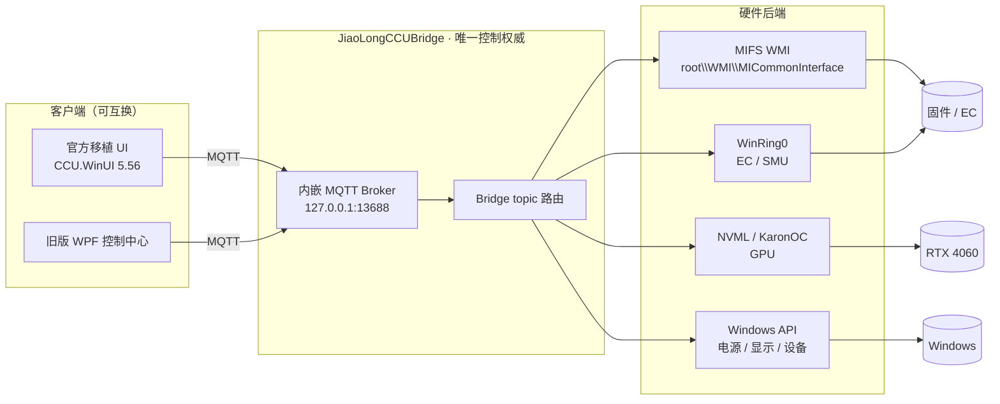

<div align="center">

# 蛟龙电竞控制台 · JiaoLongControlCenter

**机械革命「电竞控制台 5.56」在蛟龙 16 Pro 2023（MRID6）上的移植工程 —— 官方 UI 原样保留，硬件控制后端整体重写**

[](https://github.com/l2208568163-sys/JiaoLongControlCenter/releases)
[](https://github.com/l2208568163-sys/JiaoLongControlCenter/releases)
[](#-技术栈与依赖)
[](https://dotnet.microsoft.com/)
[](https://github.com/l2208568163-sys/JiaoLongControlCenter/commits/main)
[](https://github.com/l2208568163-sys/JiaoLongControlCenter/stargazers)

[项目用途](#-项目用途) · [技术栈与依赖](#-技术栈与依赖) · [目录结构](#-目录结构) · [安装与运行](#-安装与运行) · [配置说明](#-配置说明) · [常用命令](#-常用命令) · [文档](#-文档)

</div>

---

## 📌 项目用途

### 要解决的问题

机械革命最新的「电竞控制中心」（`ControlCenterX` / `CCU.WinUI` 5.56.60.34）**装不进**蛟龙 16 Pro 2023（主板 MRID6-23，同方底盘）：

1. 硬件层驱动 `UWACPIDriver` 只绑定 ACPI 设备 `INOU0000` —— 这台机器 BIOS 里**没有**这个设备，驱动装上也绑不上；
2. 服务端 `GCUService` 内置的寄存器表全是 PH4/PH6 机型，且方法体整体加密、运行时解密；
3. 即使强行安装，风扇 / 性能控制**全部失效**。

而原厂预装的旧版控制中心功能残缺，与新装的其他风扇控制软件还会互抢控制权。

### 本项目的做法

**官方 UI 原样保留，后端整个重写**：

> 官方 UI 通过 MQTT（`127.0.0.1:13688`）与自家 `GCUBridge` 通信。本项目实现同一套协议，
> 但硬件操作全部改走这台机器**固件自带**的 MIFS WMI 接口（`root\WMI\MICommonInterface`），
> 必要时才用 WinRing0 直写 EC / SMU —— **不装官方内核驱动，也不碰 EC 危险寄存器**。

三层结构：

| 层 | 内容 | 位置 |
|---|---|---|
| ① **桥接服务**（后端） | 直接访问 EC / WMI / NVML / WinRing0，对外暴露 MQTT 接口，是唯一的控制权威 | `Port/src/JiaoLongCCUBridge` |
| ② **官方 UI 移植** | 把 5.56 的 WinUI 重打包为可安装 MSIX，并把内部 MQTT 客户端指向我们的桥接 | `_work/tools`、`_work/logomod` |
| ③ **第三方应用客户端化** | 旧版「蛟龙游戏控制中心」（WPF / net9）反编译改造，控制通道同样桥接到 ① | `_work/decomp_gcc` |

结果：新旧两套客户端都只是 MQTT 客户端，**控制权统一在桥接服务**，不再互相抢风扇。
完整技术复盘见 [`Port/移植技术报告.md`](Port/移植技术报告.md)。

### 后端能力实测结论

| 能力 | 状态 | 通道 / 说明 |
|---|:---:|---|
| 性能模式（办公/均衡/狂暴/自定义） | ✅ | 固件 `SystemPerMode` |
| 一键强冷 | ✅ | EC 手动占空比 100%，实测风扇稳定 5796 RPM（厂商上限约 5800） |
| 温度墙（TCC） | ✅ | MIFS fn23 sub4，实测 TCC=61°C 时满载温度钉在 64°C、频率压到 548 MHz |
| CPU 功耗墙 SPL / SPPT | ⚠️ | 通道可用，但固件不回读，实际按默认 85/120 W |
| CPU 全核降压 | ✅ | WinRing0 → SMU `set-coall`，0–50 步 |
| 睿频开关 | ✅ | `powercfg` boost mode |
| 限制频率（FREQUENCY_MAX） | ⛔ | powrprof 在本机**无效**（AMD CPPC 不执行），功能搁置 |
| GPU 超频 / 锁频 | ✅ | KaronOC P0 偏移 / NVML `SetGpuLockedClocks`（210–3105 MHz，145 档） |
| 键盘灯效（6 种模式） | ✅ | 固件只支持有限效果，动态效果由桥接软件帧动画实现（25–40 fps，单核约 1.2%） |
| 键盘关灯 | ✅ | 必须走 `fn18=0`（`fn16=0` 被固件忽略） |
| Fn 键锁 / 触摸板开关 | ✅ | MIFS fn11 / fn12 + PTP 注册表双写 |
| Win 键锁 | ✅ | `WH_KEYBOARD_LL` 低级钩子跑在用户会话（注册表策略挡不住单独按 Win） |
| OSD 开关 | ⚠️ | 注册表已写并回读，但本机无 OSD 消费进程 |
| WiFi / 蓝牙 / 摄像头 | ✅ | 禁用 PnP 设备（语义比官方「射频软开关」更重） |
| 电池信息 | ✅ | 电池类驱动 IOCTL，拿到 WMI 拿不到的设计容量 59990 mWh / 循环 78 次 |
| 电池三档（性能/均衡/工作站） | ⚠️ | 状态记忆，本机 BIOS 无充电阈值功能号，**硬件零写入** |
| 高性能电源模式 / 深度睡眠 | ✅ | 真切电源计划 + overlay；深度睡眠映射 `HIBERNATEIDLE` |
| 关机 USB 给电 / 来电自启 / 电池 Logo / 电源灯 | ⛔ | 能力位为 0 或固件无对应功能号 |

<sub>✅ 实测生效 ｜ ⚠️ 部分可用 / 仅状态记忆 ｜ ⛔ 本机不支持或搁置</sub>

---

## 🧰 技术栈与依赖

### 运行环境

| 项目 | 要求 |
|---|---|
| 操作系统 | Windows 11 22H2 / Windows 10 19041+（x64） |
| .NET 运行时 | **目标机无需安装**（后端以自包含单文件发布）；开发机需 .NET 10 SDK |
| UI 运行时 | `Microsoft.WindowsAppRuntime 1.7`（安装包内自带 msix，已装则跳过） |
| 权限 | 管理员（加载 WinRing0 驱动、写 `HKLM` 注册表、创建服务） |
| 驱动 | WinRing0x64（EC / SMU 访问）、KaronOC（GPU 超频）—— 均随安装包分发 |

### 后端（`Port/src/JiaoLongCCUBridge`，20 个 .cs / 6035 行）

| 依赖 | 版本 | 用途 |
|---|---|---|
| .NET | 10.0 | 目标框架 `net10.0-windows` |
| `Microsoft.Extensions.Hosting.WindowsServices` | 10.0.12 | 通用宿主 + Windows 服务宿主 |
| `MQTTnet` | 4.3.7.1207 | MQTT 客户端 / 内嵌 broker |
| `System.Management` | 10.0.12 | WMI（`root\WMI\MICommonInterface`、电池） |
| `System.Diagnostics.PerformanceCounter` | 10.0.12 | CPU / 磁盘 / 网络性能计数 |
| WinRing0x64 | 随包分发 | 端口 I/O（EC / SMU）—— 动态 `LoadLibrary` 解析，不在导入表 |
| KaronOC | 随包分发 | NVIDIA P0 偏移（GPU 超频） |

### 配套工程

| 工程 | 目标框架 | 依赖 | 作用 |
|---|---|---|---|
| `Port/src/TestClient` | net10.0 | MQTTnet 4.3.7 | 协议联调客户端（自检 / 模拟 UI 发包） |
| `_work/logomod` | net8.0-windows10.0.22621.0 | WindowsAppSDK 1.7.250606001、**M2Mqtt.Net**（开源，Apache-2.0） | UI 侧注入：HomeMod / LogoMod / SettingsMod |
| `_work/patcher` | net10.0 | dnlib 4.4.0 | DLL 补丁（打补丁 / 反查构造函数） |
| `_work/ec_test` | net10.0 | 无 | EC 寄存器探测 |

### 构建与打包工具链

| 工具 | 用途 |
|---|---|
| .NET 10 SDK | 编译后端、工具、TestClient |
| Windows SDK（`makeappx` / `signtool`） | 重打包并重签名官方 MSIX |
| Python 3.10+ | `_work/tools/rebuild_ui.py`、`verify_msix.py` |
| `ilspycmd` | 反编译厂商二进制（生成参考源码，非本仓库内容） |

---

## 📁 目录结构

```
JiaoLongControlCenter/
├── Port/
│   ├── src/JiaoLongCCUBridge/          ★ 后端核心（20 个 .cs / 6035 行）
│   │   ├── Bridge.cs                   MQTT 服务端与全部 topic 路由（1729 行）
│   │   ├── HomeControls.cs             主页卡片控制项后端（392 行）
│   │   ├── EcAccess.cs                 EC 寄存器读写（WinRing0，377 行）
│   │   ├── BatteryIo.cs                电池类驱动 IOCTL 直读（347 行）
│   │   ├── WinkeyHook.cs               Win 键低级键盘钩子（327 行）
│   │   ├── Program.cs                  入口 / 服务宿主 / 命令行开关（328 行）
│   │   ├── WinPower.cs                 睿频 / 电源计划 / 休眠（318 行）
│   │   ├── UserSessionRunner.cs        用户会话内执行（301 行）
│   │   ├── KeyboardEffects.cs          键盘灯效引擎（296 行）
│   │   ├── DeviceToggles.cs            WiFi / 蓝牙 / 摄像头开关（279 行）
│   │   ├── StateStore.cs               state.json 持久化（204 行）
│   │   ├── DisplayController.cs        刷新率 / 校色（215 行）
│   │   ├── Nvml.cs                     GPU 监控与锁频（175 行）
│   │   ├── Mifs.cs                     固件 MIFS WMI 通道（169 行）
│   │   ├── SettingsGuard.cs            机型能力位与动作结果封装（157 行）
│   │   ├── RegistrySetup.cs            GamingCenter2 注册表读写（107 行）
│   │   ├── MqttHost.cs                 内嵌 broker（127.0.0.1:13688）
│   │   ├── KaronOc.cs                  KaronOC GPU 超频（67 行）
│   │   └── SettingsRestore.cs          系统选项开机恢复（33 行）
│   │
│   ├── src/TestClient/                 协议联调客户端（118 行）
│   ├── dist/JiaoLongCCU-Port-v1.0/     ★ 完整安装包（开箱即用）
│   │   ├── 1-安装移植版控制台.ps1
│   │   ├── 2-卸载移植版控制台.ps1
│   │   ├── 使用说明.md
│   │   └── payload/                    CCU.WinUI.msix / 桥接 / 原生依赖 / 运行时
│   └── 移植技术报告.md                   ★ 完整技术复盘（协议还原 + 根因 + 实测矩阵）
│
├── docs/                               ★ 工程文档（不含任何对话记录）
│   ├── BACKEND.md                      后端源码索引：模块职责 / 协议 / 构建运行
│   ├── 系统选项模块逆向分析.md            官方「系统选项」页逐协议逆向
│   ├── 系统选项功能完善说明.md            桥接侧补全与修复说明
│   ├── 键盘灯逆向分析.md                键盘灯 MIFS 帧格式与实测
│   └── 电源设置模块逆向分析与移植方案.md   电源页 8 项能力与分级移植方案
│
├── _work/                              构建管线与改造工程
│   ├── installer/                      Inno Setup 一键安装包工程
│   │   ├── setup.iss                   主脚本（路径全部相对本目录，克隆即可编译）
│   │   ├── install_service.ps1         注册并启动桥接服务
│   │   ├── install_ui.ps1              安装 MSIX UI + 导入证书 + 建快捷方式
│   │   ├── uninstall_*.ps1             卸载脚本
│   │   ├── license.txt · 使用说明.md
│   │   └── Languages/                  Inno Setup 官方中文语言文件
│   ├── tools/                          重打包管线
│   │   ├── rebuild_ui.py               解包 → 打补丁 → deps.json → makeappx → signtool
│   │   ├── verify_msix.py              回解包逐字节哈希比对
│   │   └── homemod_install.ps1         一键装机（杀 UI → 装包 → 起 UI → 验证）
│   ├── logomod/                        UI 注入（HomeMod / LogoMod / SettingsMod）
│   ├── decomp_gcc/                     第三方 WPF 应用桥接客户端化
│   ├── ec_test/ · patcher/             EC 探测 / DLL 补丁工具
│   └── *.ps1 · *.py                    逐项实测脚本（EC、显示、电池、UIA 点击等）
│
└── README.md
```

> **未入库内容**：厂商原始安装包、其余反编译产物（`decomp_ui` / `decomp_svc` / `decomp_svc_full` / `decomp_osdtp` / `decomp_bridge` / `decomp_old`）、构建中间产物。获取方式见 [docs/BACKEND.md](docs/BACKEND.md)。

---

## 🚀 安装与运行

### 方式一：使用完整安装包（推荐）

仓库已内嵌完整安装包，克隆后即可安装：

```bash
git clone https://github.com/l2208568163-sys/JiaoLongControlCenter.git
cd JiaoLongControlCenter/Port/dist/JiaoLongCCU-Port-v1.0
```

也可以从 [**Releases**](https://github.com/l2208568163-sys/JiaoLongControlCenter/releases/latest) 下载 `JiaoLongCCU-Port-v1.0.zip`（完整包）或 `JiaoLongCCUBridge-v1.0.zip`（仅桥接服务）。

**安装步骤**

1. **先关闭**其他风扇 / 性能控制软件（原厂控制中心、第三方「蛟龙游戏控制中心」、XTU、Ryzen Master 等）—— 两个程序同时控风扇会打架。
2. 右键 `1-安装移植版控制台.ps1` → **使用 PowerShell 运行**（需管理员授权）。脚本会依次：停旧实例 → 部署桥接到 `C:\Program Files\JiaoLongCCUBridge` → 注册并启动服务 → 写 `GamingCenter2` 注册表能力位 → 导入 UI 签名证书 → 安装 WindowsAppRuntime → 安装 `CCU.WinUI.msix` → 建桌面快捷方式。
3. 双击桌面【机械革命控制中心】启动。

**卸载**：右键 `2-卸载移植版控制台.ps1` → 使用 PowerShell 运行。

> 首次启动若卡在加载页超过 60 秒：管理员执行 `net stop JiaoLongCCUBridge && net start JiaoLongCCUBridge` 后重开。

### 方式二：只装桥接服务

```bat
sc create JiaoLongCCUBridge binPath= "C:\Program Files\JiaoLongCCUBridge\JiaoLongCCUBridge.exe" start= auto
sc failure JiaoLongCCUBridge reset= 86400 actions= restart/5000/restart/5000/restart/10000
sc start JiaoLongCCUBridge
```

> 官方 UI 能否正常工作还依赖 `HKLM\SOFTWARE\OEM\GamingCenter2` 下的能力开关与品牌配置（由完整包的安装脚本写入）。
> 只用桥接包时，官方 UI 需要你已用完整包装过一次；若只是给旧版 WPF 控制中心或其他 MQTT 客户端当控制后端，则无需这些注册表。

### 方式三：从源码构建

```bash
# 调试构建
dotnet build Port/src/JiaoLongCCUBridge -c Debug

# 发布为自包含单文件（目标机无需装 .NET）
dotnet publish Port/src/JiaoLongCCUBridge -c Release -r win-x64 \
  --self-contained true -p:PublishSingleFile=true
```

产物在 `Port/src/JiaoLongCCUBridge/bin/Release/net10.0-windows/win-x64/publish/`。
原生依赖（KaronOC / WinRing0）会按「仓库内 payload → 本机 `JiaoLong7.3`」顺序自动查找并复制到输出目录；两者都没有时只给 Warning，程序仍可编译，但 GPU 超频与 EC 直写不可用。

> 提示：`publish` 前若报 `CS2012 obj\...dll 被 VBCSCompiler 锁定`，先执行 `dotnet build-server shutdown`。

### 官方 UI 重打包（进阶）

需自备官方 `ControlCenter_5.56.60.34_Mechrevo_GX.exe`：

```bash
python _work/tools/rebuild_ui.py    # 解包 → 四个补丁 → deps.json 登记 → makeappx → signtool
python _work/tools/verify_msix.py   # 回解包逐字节哈希比对
```

---

## ⚙️ 配置说明

### MQTT

| 项 | 值 |
|---|---|
| 地址 | `127.0.0.1:13688`（内嵌 broker，仅本机回环） |
| 凭据 | `UWPClient_User_5` / `UWPClient_Pwd888881772688_5`（沿用官方 UI 内置值） |
| 端口常量 | `Bridge.BrokerPort`（`Bridge.cs`） |

主要 topic：

| 方向 | Topic | 说明 |
|---|---|---|
| UI → 服务 | `Setting/Control` | 系统选项 / 电源 / 显示等设置动作 |
| UI → 服务 | `Keyboard/Ctrl` | 键盘灯效控制（效果、速度、亮度、方向、调色板） |
| UI → 服务 | `BatteryProtection/Control` | 电池模式 |
| UI → 服务 | `Home/*` | 主页卡片控制项（性能模式、睿频、强冷、温度墙） |
| 服务 → UI | `Setting/Status` | 设置项状态回发（带 1 秒防回声窗口） |
| 服务 → UI | `Keyboard/Status` | 键盘状态回发 |
| 服务 → UI | `System/BatteryProtection` | 电池模式回发 |
| 服务 → UI | `JiaoLong/HomeStatus` | 主页状态回发 |

### 文件与目录

| 路径 | 内容 |
|---|---|
| `C:\Program Files\JiaoLongCCUBridge\` | 安装后的桥接服务与原生依赖 |
| `C:\ProgramData\JiaoLongCCUBridge\state.json` | 用户设置持久化（原子写；损坏时备份为 `.corrupt`） |
| `C:\ProgramData\JiaoLongCCUBridge\bridge_YYYYMMDD.log` | 服务日志 |
| `C:\Users\Public\JiaoLongCCUBridge\` | 与用户会话进程的交换目录（`winkey.lock` / `winkey.heartbeat` / `winkey_hook.log`） |
| `C:\ProgramData\CCU_Gallery\Info\` | 官方 UI 日志 |
| `C:\ProgramData\JiaoLongLogoMod\log.txt` | Logo 补丁日志 |

### 注册表

| 键 | 用途 |
|---|---|
| `HKLM\SOFTWARE\OEM\GamingCenter2` | 品牌与能力开关（`AppName`、`Language`、`CustomizeTarget`、`BIOS_PROJECT_ID`…） |
| `HKLM\SOFTWARE\OEM\GamingCenter2\ItemSupport` | 能力位（决定官方 UI 显示哪些页面/项目） |
| `HKLM\SOFTWARE\OEM\GamingCenter2\MySetting` | OSD 隐藏等开关（`OSDHidden`） |
| `HKLM\SOFTWARE\OEM\GamingCenter2\MySetting\DisplayFeatures` | 校色开关 |
| `HKCU\Software\JiaoLongLogoMod\CustomLogoPath` | 主页自定义 Logo 路径（删除即恢复默认） |

> 服务端会读 `ItemSupport` 能力位决定**接受不接受**某类指令，与 UI 的**显示与否**保持一致，避免出现「UI 不显示但指令仍被执行」。

### 服务与账户

| 项 | 值 |
|---|---|
| 服务名 | `JiaoLongCCUBridge` |
| 账户 | LocalSystem（需要写 `HKLM`、加载驱动） |
| 失败恢复 | 5s / 5s / 10s 重启，24 小时后重置计数 |

### 环境差异说明

- **Session 0 限制**：服务无法直接操作用户桌面或弹窗，因此需要交互的动作（刷新率切换、显示助手脚本）通过 `UserSessionRunner` 在用户会话中执行；`CreateProcessAsUserW` 的 `lpDesktop` **必须留空**，否则进程会静默退出。
- **Win 键钩子**：`WH_KEYBOARD_LL` 只对安装它的会话生效，故钩子以普通用户身份跑在用户会话，用 `Local\` 互斥体与 Public 交换目录通信（普通用户无 `SeCreateGlobalPrivilege`，也不能写 SYSTEM 的日志目录）。
- **官方 UI 回声**：UI 收到状态后会反向触发一次命令，服务端用 1 秒「防回声窗口」压住乒乓。

---

## ⌨️ 常用命令

### 后端自检与调试

| 命令 | 说明 |
|---|---|
| `JiaoLongCCUBridge.exe --console` | 前台运行并输出日志到控制台 |
| `JiaoLongCCUBridge.exe --battest` | 只读自检：电池信息（设计容量/循环/健康）、电源计划、休眠超时 |
| `JiaoLongCCUBridge.exe --ecscan` | 扫描 EC 寄存器区间 |
| `JiaoLongCCUBridge.exe --devtest` | 设备控制自检 |
| `JiaoLongCCUBridge.exe --powertest on` | 切高性能电源计划 + 最佳性能 overlay（**会改系统**） |
| `JiaoLongCCUBridge.exe --powertest off` | 切平衡电源计划 + 平衡 overlay（**会改系统**） |
| `JiaoLongCCUBridge.exe --powertest deep <秒>` | 写 `HIBERNATEIDLE`（0 = 从不，**会改系统**） |
| `JiaoLongCCUBridge.exe --send <topic> <json>` | 模拟 UI 下发，走完整业务路径（不用点界面即可验证服务端动作） |
| `JiaoLongCCUBridge.exe --winkey-hook` | 以用户身份启动 Win 键钩子进程（服务会自动拉起，一般无需手动执行） |

示例：

```bash
JiaoLongCCUBridge.exe --send Setting/Control "{\"Action\":\"DEEPSLEEP_ON\",\"Secs\":900}"
JiaoLongCCUBridge.exe --battest
```

### 协议联调（TestClient）

```bash
dotnet run --project Port/src/TestClient -- hometest      # 主页控制项协议自检
dotnet run --project Port/src/TestClient -- batterytest   # 电池页自检（前半）
dotnet run --project Port/src/TestClient -- batterytest2  # 电池页自检（后半：还原状态）
dotnet run --project Port/src/TestClient -- send <topic> <json>
```

### 服务运维

```powershell
Get-Service JiaoLongCCUBridge          # 查看状态
Restart-Service JiaoLongCCUBridge      # 重启
Get-Content "C:\ProgramData\JiaoLongCCUBridge\bridge_$(Get-Date -Format yyyyMMdd).log" -Tail 50
```

### UI 管线

```bash
python _work/tools/rebuild_ui.py       # 重打包官方 MSIX
python _work/tools/verify_msix.py      # 校验
powershell -ExecutionPolicy Bypass -File _work/tools/homemod_install.ps1   # 一键装机
```

### 一键安装包（Inno Setup）

```bash
# 需要 Inno Setup 6（ISCC.exe 在 PATH 或用完整路径调用）
iscc _work/installer/setup.iss
# 产物：Port/dist/JiaoLongCCU-Setup-1.1.0.exe
```

安装包支持「完整安装 / 仅桥接服务」两种模式，安装时自动停旧服务、注册服务、导入 UI 证书、
安装 MSIX 并创建桌面快捷方式；卸载时自动清理服务与注册表键。脚本内路径全部相对仓库目录，
克隆到任意位置都能直接编译。

### 其他

```bash
dotnet build-server shutdown           # publish 前解除 obj 目录锁定
ilspycmd -p -o _work/decomp_ui <dll>   # 重新生成反编译参考源码
```

---

## 🏗 工作原理



---

## 🩺 常见问题

<details>
<summary><b>启动卡在加载页 / 界面数据显示 “-”</b></summary>

桥接服务没起来。管理员 PowerShell：

```powershell
Get-Service JiaoLongCCUBridge      # 应为 Running
Restart-Service JiaoLongCCUBridge
```
</details>

<details>
<summary><b>摄像头开关点了没反应</b></summary>

本机 Integrated Camera（`USB\VID_2EFE&PID_6460`）被驱动否决（`CR_REMOVE_VETOED`），
`Disable-PnpDevice` 同样失败 —— 不是实现问题。先关掉占用摄像头的程序再试。
</details>

<details>
<summary><b>键盘灯「关闭」按钮没反应</b></summary>

固件忽略 `fn16=0`，关灯必须走亮度 `fn18=0`。桥接已按此实现，旧版 UI 包可能未包含该修复。
</details>

<details>
<summary><b>风扇曲线改了不生效</b></summary>

固件的 `fn20/fn21` 风扇曲线接口在本机无效（写入回读一致但不驱动风扇）。
独立曲线需走 WinRing0 直写 EC `0xC83C/0xC83D`，且必须先写 `0xB20` 手动位（只能直写 0 / 0x02）。
</details>

<details>
<summary><b>「限制频率」改了没用</b></summary>

本机电源计划没有 `FREQUENCY_MAX`，`THROTTLE_MAX` 虽然写入成功但 AMD CPPC 不执行 —— 该功能在 MRID6 上搁置。
</details>

<details>
<summary><b>和旧版「蛟龙游戏控制中心」能共存吗</b></summary>

可以安装共存，但**不能同时运行** —— 两个程序都在控风扇，会互相打架。
</details>

<details>
<summary><b>自定义模式在电池供电下是灰的</b></summary>

这是官方 UI 自身的行为，插上电源适配器即可用。
</details>

<details>
<summary><b>怎么恢复默认 Logo</b></summary>

删除注册表值 `HKCU\Software\JiaoLongLogoMod\CustomLogoPath` 后重启应用。
</details>

---

## 📚 文档

| 文档 | 用途 |
|---|---|
| [`README.md`](README.md) | 总览、安装、配置、命令（本文件） |
| [`docs/BACKEND.md`](docs/BACKEND.md) | 后端源码索引：模块职责、协议约定、构建运行 |
| [`Port/移植技术报告.md`](Port/移植技术报告.md) | 完整技术复盘：协议还原、逐项根因、实测矩阵 |
| [`docs/系统选项模块逆向分析.md`](docs/系统选项模块逆向分析.md) | 官方「系统选项」页逐协议逆向与本机能力位 |
| [`docs/系统选项功能完善说明.md`](docs/系统选项功能完善说明.md) | 桥接侧对系统选项的补全与修复说明 |
| [`docs/键盘灯逆向分析.md`](docs/键盘灯逆向分析.md) | 键盘灯 MIFS 帧格式与 6 种灯效的实现 |
| [`docs/电源设置模块逆向分析与移植方案.md`](docs/电源设置模块逆向分析与移植方案.md) | 电源页 8 项能力与分级移植方案 |
| `Port/dist/JiaoLongCCU-Port-v1.0/使用说明.md` | 面向使用者的安装说明 |

---

## ⚠️ 免责声明

- 本项目是**个人设备上的私有改造**，与机械革命 / 同方（UNIWILL）**无任何关联**，非官方产品。
- 涉及 **EC 写入、SMU 降压、GPU 超频、WinRing0 内核驱动加载**等高风险操作，**仅在 MRID6 机型验证**。修改电压电流有损坏硬件甚至变砖的可能，**风险完全自负**。
- `CCU.WinUI.msix` 为机械革命官方 UI 的**重签名重打包版本**，版权归原厂所有；本仓库仅作个人设备修复用途分发，**请勿商用**。
- 仓库内 `_work/decomp_gcc` 等目录包含的反编译代码仅用于**互操作研究与自有设备修复**，版权归原厂所有。
- 因使用本项目导致的硬件损坏、数据丢失或保修失效，作者不承担任何责任。

**使用前请自行确认所在地区法律与厂商条款允许此类修改。如果不接受以上任何一条，请勿下载、安装或使用。**

---

<div align="center">
<sub>如果这个项目帮到了你，点个 ⭐ 是对作者最大的鼓励</sub>
</div>
